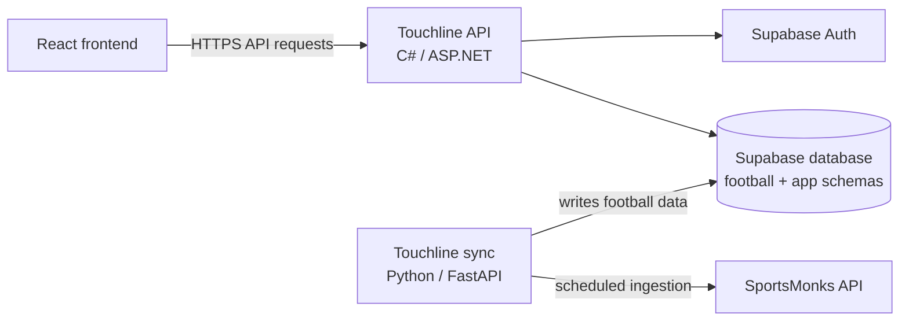

# Touchline architecture and implementation plan

This is the current implementation plan based on the approved architecture
diagram. The diagram defines the target system boundaries; folders and files in
this checkout are not all of the target services.

## Target architecture

- **React frontend:** presents screens and calls the ASP.NET API. It must not
  contain database service credentials or write directly to Supabase.
- **ASP.NET API:** the single user-facing backend. Controllers handle HTTP,
  services implement business operations, fantasy services implement game
  rules, models define request/response and persistence shapes, and user
  services map authenticated Supabase identities to Touchline profiles.
- **Supabase:** Supabase Auth provides identity. The `football` schema contains
  data owned by the sync service. The `app` schema contains Touchline-owned
  records such as fantasy teams, picks, leagues, and fantasy scores.
- **Python sync service:** fetches SportsMonks data and updates the football
  schema. It does not handle user login, fantasy team edits, or league actions.
- **Database migration ownership:** the sync-worker/backend database repo named
  by the project README is the canonical home for schema migrations. Do not
  maintain a second production migration history in the frontend repo.

## Request and data flow

1. The user signs in through Supabase Auth. The frontend receives an access
   token and sends it as a Bearer token to the ASP.NET API.
2. ASP.NET validates the token, resolves the Touchline user profile, checks
   permissions, and calls the appropriate service.
3. For read-only PSL data, the API reads the football tables populated by the
   sync service. The sync service remains the only writer for that source data.
4. For fantasy actions, the API validates the user and rules, then writes to
   the app schema. Fantasy scores are calculated from completed match data and
   saved against the relevant team and gameweek.
5. The frontend renders the API response. It may cache data for responsiveness,
   but the database remains the durable source of truth.

## Fantasy API contract to implement in ASP.NET

All routes below require a valid Supabase access token unless explicitly
identified as public. The API must derive the user ID from the verified token,
never trust a user ID in a request body.

| Route | Purpose |
| --- | --- |
| `GET /api/v1/players` | Return current-season players, club, position, and database price. |
| `GET /api/v1/fantasy/team` | Load the signed-in user's team for the active season. |
| `PUT /api/v1/fantasy/team` | Create or update the 15-player squad after server-side validation. |
| `POST /api/v1/fantasy/chip` | Activate an allowed chip under gameweek rules. |
| `GET /api/v1/fantasy/teams/{userId}` | Return the permitted team view for another user. |
| `GET /api/v1/fantasy/leagues` | List the signed-in user's leagues. |
| `POST /api/v1/fantasy/leagues` | Create a league and invite code. |
| `POST /api/v1/fantasy/leagues/join` | Join a league by code; enforce the 20-member cap atomically. |
| `GET /api/v1/fantasy/leagues/{id}` | Return league members and permitted team summaries. |
| `GET /api/v1/fantasy/leagues/{id}/standings` | Return overall or selected-gameweek standings. |

The existing football read endpoints should also be moved behind the same
ASP.NET API over time, so the React app has one API connection and no direct
database access.

## Work plan and ownership

### 0. Locate and align the service repositories

- Decide whether the new `Touchline API/` project will be split into its own
  Git repository or placed in the team's existing ASP.NET backend repo.
- Locate the Python sync-worker repo.
- Confirm the deployed Supabase project and current database schema before
  applying migrations.
- Agree on route names, auth claims, IDs, current-season selection, gameweek
  identity, and error formats across all four workstreams.
- Move the fantasy schema draft out of the frontend repo into the canonical
  migration repo after matching it to the live schema.

### 1. Authentication and user profile — Person 1

- Replace browser-only account storage with Supabase Auth.
- Add ASP.NET JWT validation and a user-profile service.
- Create or reconcile the app profile for each authenticated Supabase user.
- Add account recovery, logout, and profile update flows.

### 2. ASP.NET API and fantasy persistence — Person 2

- Implement controllers, request/response models, services, and Supabase data
  access in the existing C# backend project.
- Port the current fantasy API contract and rules from the frontend prototype
  into C# services; do not make the Netlify function the production API.
- Persist teams, picks, chips, leagues, membership, and gameweek scores through
  the canonical schema migration.
- Enforce roster, formation, price/budget, club cap, owner access, and league
  capacity on the server and in atomic database operations where needed.
- Provide an authorized team-view endpoint for other users and document what
  becomes visible and when.

### 3. Frontend experience and integration — Person 3

- Build team selection, formation, captain/vice-captain, bench, budget, and chip
  flows using the agreed ASP.NET contract.
- Add saved team, score breakdown, gameweek history, league discovery/join, and
  other-member team views.
- Replace direct Netlify/data-source calls with the ASP.NET base URL as the API
  coverage is migrated.
- Add loading, validation, empty, offline, and server-error states.

### 4. Match data and fantasy scoring — Person 4

- Use only completed, valid fixtures in the selected season/gameweek.
- Map player-level minutes, goals, assists, and clean sheets from the football
  schema to the confirmed scoring rules.
- Make score calculation repeatable and safe to rerun after corrected source
  data; persist per-player and team totals for each gameweek.
- Coordinate with the sync worker owner on missing or late match events.

## Delivery gates

1. **Architecture gate:** backend and sync repos are identified; schema owner,
   Supabase project, auth provider, and shared API contract are confirmed.
2. **Backend gate:** authenticated ASP.NET endpoints work against a test
   Supabase project; database rules reject invalid teams and league overflows.
3. **Scoring gate:** fixtures and player events produce correct reproducible
   scores for a test gameweek, including captain, vice-captain, and chips.
4. **Frontend gate:** a user can sign in, build and save a team, reopen it on a
   second session, view another permitted team, and compete in a league.
5. **Release gate:** migrations are applied through the canonical repo, secrets
   are configured server-side, and staging end-to-end checks pass.

## Current repository status and boundary

- This checkout contains the React frontend, separate news API, and the new
  `Touchline API/Touchline.Api` ASP.NET project folder. The ASP.NET code is
  currently in the same Git repository as the frontend; a folder boundary is
  not yet a repository/deployment boundary.
- The Python sync-worker source is not in this checkout.
- The frontend currently has a browser-local auth implementation and a
  Netlify fantasy API prototype. Neither is the target production architecture.
- The ASP.NET project has controllers, services, models, Supabase token
  validation, a player catalog endpoint, fantasy endpoints, and scoring
  calculations. It builds; Supabase-backed routes still need configuration.
- A fantasy schema proposal is in `Touchline API/Database/`; it has not been
  confirmed against the live database and must be reviewed in the owning
  database repo before it is applied.
- The existing fantasy scoring helpers are useful rule references, but match
  scoring, database persistence, and real login must be completed in their
  target services before fantasy is end-to-end functional.

## Local development target

Run the React app, ASP.NET API, and (when needed) Python sync service as separate
processes. Configure the frontend's API base URL to the local ASP.NET address.
The ASP.NET service should use local or staging Supabase credentials supplied
through server-side environment configuration. Never put a service-role key in
the Vite `VITE_*` environment.
